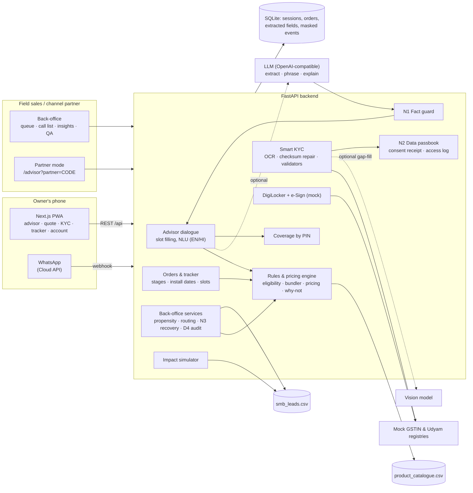

# Solution architecture

**Principle: the LLM talks, deterministic code decides.** Eligibility, prices, KYC verdicts and routing all come from code over the case data. The LLM, which is optional and set by provider-neutral environment variables, extracts facts from free text, rephrases into the owner's language and writes the "why". Everything it writes passes the fact guard.

## Request flow per journey step

| Step | Call | What happens |
| --- | --- | --- |
| Advisor | `POST /api/advisor/sessions/{id}/messages` | NLU (+ LLM) extracts facts → code picks the next question → once enough is known, `build_offer` returns 3 tiers → LLM explanation vetted by the fact guard |
| Quote | `POST /api/quote` | Toggled items re-priced by `pricing.quote` (one GST-inclusive monthly price) |
| Order | `POST /api/orders` | Bundle re-validated by `rules.check_bundle`; tracker plan from `typical_install_days` |
| KYC | `POST /api/orders/{id}/consent` → `/documents/{slot}` → `/kyc/verify` | Consent receipt issued → OCR in memory (image discarded) → GSTIN checksum, registry status, cross-document, 90-day checks → GST-only products blocked on a bad GSTIN |
| Tracker | `GET /api/orders/{id}`, `/passbook` | Stage timeline, planned dates, proactive updates, data passbook |
| Back-office | `GET /api/backoffice/queue`, `/call-list`, `/insights` | Ranked by propensity (AUC 0.73), routed, each with an engine-priced recovery offer; leads audit |

## Production path (not built)
SQLite becomes Postgres with row-level security, and documents stay in memory only, as they do now. The mocks are replaced by GSTN/Udyam APIs through a GSP, real DigiLocker Requester APIs, Aadhaar e-Sign through an ESP, Bhashini ASR/TTS for more languages, UPI AutoPay mandates, and the network inventory API in place of the PIN mock.
